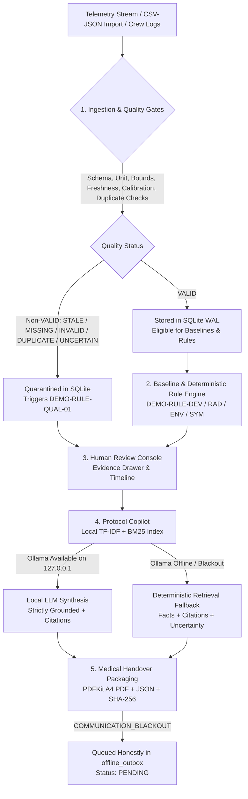
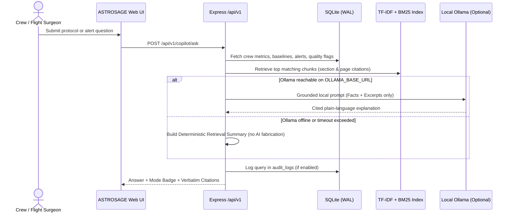

# ASTROSAGE — Offline-First Astronaut Health Intelligence & Protocol Copilot

**Monitor. Understand. Verify. Guide. Report.**

**ASTROSAGE** is an offline-first aerospace health intelligence and protocol decision-support workspace built for space missions where Earth communication is delayed, intermittent, or temporarily unavailable. It consolidates simulated physiological telemetry, crew-reported symptoms, radiation dosimetry, habitat environmental readings, and cognitive checks into one local-first review console—backed by SQLite persistence, deterministic explainable rules, a grounded local-reference Copilot, and verifiable PDF/JSON medical handover reports.

> **Important Scientific & Safety Notice**
> ASTROSAGE is a **research prototype and decision-support interface**. It is **not** an AI doctor, is **not** clinically validated or flight-qualified, and does **not** claim NASA affiliation, endorsement, or partnership.
> - It **never** diagnoses medical conditions, prescribes medications or doses, determines clinical fitness, autonomously clears astronauts for EVA, or replaces qualified flight surgeons.
> - All built-in crew, mission, and telemetry datasets are synthetic and explicitly labelled as **Simulated**.
> - Physical dosimetry quantities (**Gray / Gy** for absorbed dose and **Sievert / Sv** for effective or ambient dose equivalent) are strictly separated and never auto-converted.

---

## Table of Contents
1. [Core Modules](#core-modules)
2. [Application Pages & Features](#application-pages--features)
3. [How It Works — System Workflows](#how-it-works--system-workflows)
4. [Architecture & Tech Stack](#architecture--tech-stack)
5. [Project Structure](#project-structure)
6. [Environment Variables](#environment-variables)
7. [Local Installation & Launch](#local-installation--launch)
8. [API Overview (`/api/v1`)](#api-overview-apiv1)
9. [Automated Tests & Verification](#automated-tests--verification)

---

## Core Modules

ASTROSAGE is organized around two principal operational modules supported by local SQLite persistence and a dual-theme Swiss clinical instrument interface (**Lab-Paper Light** default and **Flight-Deck Dark** mode):

### 1. ASTROSAGE Monitor
- **Validated Telemetry Ingestion & Quality Gatekeeping**: Checks incoming physiological, environmental, and radiation records for schema validity, plausibility bounds, measurement units, sensor calibration state, timestamp freshness, and duplicate signatures. Records are classified as `VALID`, `STALE`, `MISSING`, `INVALID`, `UNCERTAIN`, or `DUPLICATE`. Non-`VALID` records are quarantined and excluded from baseline math.
- **Personal Baseline Engine (`v1+`)**: Computes personal statistics (mean, median, standard deviation, IQR, sample count) only when sufficient valid observations exist (`>= 8` samples). Baselines remain locked unless an operator explicitly requests recalculation with reviewer attribution.
- **Deterministic, Explainable Review Flags**: Evaluates transparent rules against valid telemetry and logs:
  - `DEMO-RULE-DEV-01` / `DEMO-RULE-DEV-02`: Sustained deviation (`>= 1.5 SD` WATCH, `>= 2.5 SD` URGENT REVIEW) across 3 consecutive valid readings.
  - `DEMO-RULE-QUAL-01`: Quarantined sensor faults or missing/stale telemetry gaps.
  - `DEMO-RULE-RAD-01`: Elevated dosimetry intervals (`mGy` and `mSv` tracked independently).
  - `DEMO-RULE-ENV-01`: Habitat environmental shifts (e.g., elevated cabin `CO2` or thermal excursions).
  - `DEMO-RULE-SYM-01`: Crew-reported symptoms reaching review severity (`>= 3/5`).
- **Integrated Health & Mission Timeline**: Merges health readings, symptoms, radiation exposures, habitat events, cognitive checks, and system flags into a synchronized filterable stream.

### 2. ASTROSAGE Copilot
- **Local Reference Library & Hybrid Retrieval**: Chunks and indexes local Markdown protocol documents (`data/knowledge/*.md` plus operator-uploaded protocols) in SQLite using in-process TF-IDF + BM25 scoring, preserving exact document titles, versions, section headers, and page numbers.
- **Grounded Response Pipeline**:
  - **Local LLM Mode (Optional Ollama)**: When a local Ollama daemon (`127.0.0.1:11434`) is reachable, prompts stay completely on localhost and synthesize answers strictly grounded in SQLite facts and retrieved protocol chunks.
  - **Deterministic Retrieval-Only Fallback**: When Ollama is offline or unreachable, ASTROSAGE explicitly indicates `Local AI unavailable (Retrieval Fallback)` and compiles an honest, deterministic summary separating **Recorded Facts**, **Calculated / Baseline Context**, **Retrieved Protocol Citations**, and **Uncertainty / Missing Information**—never fabricating AI reasoning.
- **Structured Medical Handover Reports**: Generates downloadable A4 **PDF** (`pdfkit`) and **JSON** handover packages stamped with a **SHA-256 content hash** and explicit human-review boundaries.

---

## Application Pages & Features

The left navigation rail provides 10 purpose-built operational views, complemented by a persistent top bar (mission selector context, crew switcher, simulated Mission Elapsed Time, offline status indicator, active alert counter, theme toggle, and **Start Demo** presenter guide):

1. **Mission Overview**
   - Live animated **Simulated Lead-II Cardiac Rhythm Monitor** canvas (`25 mm/s`, `10 mm/mV`, live `R-R` interval in `ms`, Freeze toggle).
   - **Unified Hairline Telemetry Summary Strip**: Crew health record count, active review flags, radiation records, environmental coverage (`%`), data-quality warnings, and latest UTC timestamp.
   - Interactive physiological trend chart (`HR`, `SpO2`, `Temp`, `Resp`) overlaid on the crew member's `±1.5 SD` demonstration baseline band.
   - Live Mission Activity Feed, Explainable Review Flags preview, and Radiation/Habitat/Symptom snapshot.
   - Controls for **Live Stream** (5-second simulated packet ingestion) and **Simulate +15m Packet**.

2. **Health Monitor**
   - Unified biometric summary strip with latest values, quality tags, and baseline status.
   - Personal baseline bay (`mean`, `median`, `SD`, `IQR`, sample count) with **Explicit Baseline Recalculation** modal/control (requires operator attribution and reason).
   - **Manual Health Reading** and **Crew Symptom Log** forms that immediately trigger ingestion validation and deterministic rule re-evaluation.
   - Full explainable review flag list with slide-over **Record Evidence Drawer** (`What happened`, `Measurements`, `Baseline`, `Missing info`, `Human review reason`, `Acknowledge`, and `Ask Copilot`).

3. **Radiation & Environment**
   - Enforces strict separation between **Absorbed Dose (`Gy / mGy`)** and **Effective / Ambient Dose Equivalent (`Sv / mSv`)** with independent charts and tables.
   - Displays dosimeter calibration references (`CALIBRATED` vs `UNCALIBRATED`), measurement uncertainty, and non-causation advisories.
   - Tracks habitat **ECLSS environmental telemetry** (`CO2 mmHg`, cabin pressure, temperature, humidity) across habitat nodes, plus manual logging forms.

4. **Health Timeline**
   - Chronological multi-stream mission timeline (24h / 48h / 72h adjustable range slider).
   - Category filter bar (`HEALTH`, `RADIATION`, `ENVIRONMENT`, `SYMPTOM`, `COGNITIVE`, `ALERT`) with live event counts.
   - Clickable timeline entries opening the detailed provenance and quality inspection drawer.

5. **Protocol Copilot**
   - Conversational evidence-grounded workspace with suggested verification prompts and direct **Local Reference Search**.
   - Displays exact resolved citations (`Document Title`, `Section`, `Page`, `Version`, `Chunk ID`, `Score`, and verbatim excerpt) alongside transparent response mode (`Offline / Local AI` vs `Deterministic Retrieval Summary`).

6. **Medical Reports**
   - Configurable handover generator allowing selection of review window (`24h`, `48h`, `72h`) and report sections (`Health`, `Symptoms`, `Radiation`, `Environment`, `Alerts`, `Data Quality`).
   - Live light off-white **Printable Handover Preview** (`A4` format) and persistent archive with **Download PDF**, **Download JSON**, and full **SHA-256** integrity digests.

7. **Data Explorer**
   - Tabbed raw SQLite record inspector (`Health`, `Radiation`, `Environment`, `Symptoms`, `Cognitive`) with text search, quality-status filtering, and filtered JSON export.
   - **Validated CSV / JSON Import Pipeline** with downloadable sample templates, local file upload, and row-level **Import Validation Diagnostics** (`Received`, `Accepted`, `Rejected`, `Duplicates`, `Missing`, plus exact field/reason error table).

8. **Demo Scenarios**
   - One-click deterministic scenario loader for demonstrating every system state:
     - **Scenario A — `NORMAL_MISSION`**: Nominal variation within `±1.5 SD`, calibrated sensors, zero deviation alerts.
     - **Scenario B — `GRADUAL_HEALTH_DRIFT`**: Progressive resting HR rise (`~66 -> 94.2 bpm`), rising temperature/respiration, shorter sleep, and symptom report triggering `DEMO-RULE-DEV-02`.
     - **Scenario C — `EXPOSURE_CONTEXT`**: Overlapping elevated `mGy` / `mSv` intervals, raised cabin `CO2`, and mild headache report demonstrating separate units and non-causation review.
     - **Scenario D — `SENSOR_FAULT`**: Injects `MISSING` (`null`), `INVALID` (`-18 bpm`, `104.2% SpO2`), `DUPLICATE`, `STALE` (28h old), and `UNCALIBRATED` records quarantined by quality gates.
     - **Scenario E — `COMMUNICATION_BLACKOUT`**: Simulates Earth link loss and queues local writes in `offline_outbox` without fabricating remote synchronization.
   - Includes **Reset Active Scenario** and two-step **Clear Demo Data** controls.

9. **System Status**
   - Live subsystem health matrix checking Express API, SQLite WAL database, Ollama LLM daemon, configured model discovery, local TF-IDF/BM25 engine, indexed document/chunk counts, and PDFKit report service.
   - **Runtime Environment Variables (`process.env`)** table showing resolved non-secret server variables and whether each came from `process.env` or default fallback.
   - **Pending Offline Outbox** and **Local Audit Log** viewers.

10. **Settings**
    - Persists **Lab Light / Flight Dark** theme, active crew profile, active mission, default timeline window, Ollama endpoint/model, and Copilot audit logging to SQLite.
    - Includes **Reset to `.env` Defaults** button, full **Export Local Backup (JSON)** download, and **Index Additional Local Protocol Document** form to chunk and index custom Markdown protocols into SQLite.

---

## How It Works — System Workflows

### End-to-End Operational Workflow



### Protocol Copilot Grounding & Offline Fallback Workflow



### Detailed Step-by-Step Workflows

1. **Telemetry Ingestion & Quarantine Workflow**
   - When a manual entry, simulated `+15m` packet, or CSV/JSON batch arrives at `/api/v1/readings/*` or `/api/v1/import`:
     1. Row-level validation checks required identifiers, ISO-8601 timestamps, numeric parsing, unit match (for example rejecting `mSv` paired with `ABSORBED_DOSE`), physical bounds, calibration state, freshness (`> 18h` marked `STALE`), and duplicate keys.
     2. Accepted rows are written to SQLite (`health_readings`, `radiation_readings`, `environmental_readings`, or `symptom_logs`), and any malformed batch rows are returned with row numbers, fields, and rejection reasons.
     3. Only `VALID` rows feed personal baseline envelopes and deviation calculations.

2. **Explainable Alert & Review Workflow**
   - After ingestion or scenario loading, `evaluateDeterministicAlerts()` runs against the crew member's valid readings and locked baseline.
   - Each generated alert records its rule ID/version, triggering record IDs, exact measurements, baseline stats, what comparison was performed, missing context, and why human review is required.
   - Operators inspect alerts in the **Record Drawer**, optionally acknowledge them with reviewer name and notes (persisted to `alerts` and `audit_logs`), or launch **Protocol Copilot** pre-filled with the alert context.

3. **Protocol Copilot Grounded Query Workflow**
   - On startup, built-in protocols in `data/knowledge/` (plus any custom operator documents) are split by Markdown section headings into citable chunks with page estimates.
   - When a user asks a question (`POST /api/v1/copilot/ask`):
     1. The local retriever scores chunks using TF-IDF + BM25 and extracts the top supporting excerpts.
     2. The server fetches the active crew overview, flags, data-quality warnings, and radiation/environment context from SQLite.
     3. If Ollama responds within `OLLAMA_TIMEOUT_MS`, the local model synthesizes an answer constrained to those facts and citations.
     4. If Ollama is unreachable, ASTROSAGE immediately returns a structured deterministic retrieval summary with exact section/page citations and explicit uncertainty disclosures.

4. **Medical Handover Packaging Workflow**
   - Selecting **Generate Handover Report** (`POST /api/v1/reports/generate`) snapshots the chosen time window (`24h`/`48h`/`72h`) and selected sections, computes a **SHA-256** digest over the payload, saves the record in SQLite, and serves on-demand `PDFKit` binary PDFs (`/api/v1/reports/:id/pdf`) and raw JSON archives (`/api/v1/reports/:id/json`).

5. **Offline & Blackout Synchronization Workflow**
   - During `COMMUNICATION_BLACKOUT`, writes (manual readings, symptom logs, scenario actions) persist locally in SQLite and append `PENDING` entries to `offline_outbox`. ASTROSAGE never pretends unconfirmed remote synchronization succeeded.

---

## Architecture & Tech Stack

| Layer | Technology | Purpose |
| :--- | :--- | :--- |
| **Frontend** | React 19, TypeScript, Vite, Tailwind CSS v4 | Single-page mission console with Lab-Paper Light & Flight-Deck Dark themes |
| **Data Visualization** | Recharts, HTML5 Canvas, Lucide React | Physiological baseline envelopes, dosimetry/ECLSS charts, animated ECG waveform |
| **Typography** | `@fontsource/ibm-plex-sans`, `@fontsource/ibm-plex-mono` | Locally bundled fonts (zero external CDN requests offline) |
| **Backend** | Express + TypeScript (`server.ts`, `tsx`) | REST API (`/api/v1/*`), Vite dev middleware / static prod serving |
| **Database** | Node built-in SQLite (`node:sqlite`, WAL mode) | Local persistence with versioned schema migrations (`data/astrosage.db`) |
| **Local AI & Search** | In-process TF-IDF + BM25, optional Ollama (`127.0.0.1:11434`) | Grounded citation retrieval + localhost LLM or honest deterministic fallback |
| **Document Export** | `pdfkit`, Node `crypto` | Server-side A4 medical handover PDF generation with SHA-256 verification |

---

## Project Structure

```text
├── server.ts                          # Express + Vite/static entry point
├── index.html                         # HTML shell & metadata
├── .env.example                       # Documented non-secret runtime env vars
├── data/
│   ├── astrosage.db                   # Auto-created SQLite WAL database
│   └── knowledge/                     # Built-in Markdown reference protocols
│       ├── astrosage-telemetry-baselines-guide.md
│       ├── crew-handover-protocol-sop.md
│       ├── habitat-environmental-monitoring.md
│       └── radiation-dosimetry-gy-sv-primer.md
├── scripts/
│   ├── start-offline.sh               # macOS/Linux strict localhost offline launcher
│   └── start-offline.bat              # Windows strict localhost offline launcher
└── src/
    ├── App.tsx                        # Main workspace state, navigation, theme sync
    ├── index.css                      # Lab-Paper Light & Flight-Deck Dark design tokens
    ├── lib/api.ts                     # Typed frontend client for /api/v1/*
    ├── shared/types.ts                # Shared TypeScript domain contracts
    ├── components/
    │   ├── layout/                    # Sidebar, TopBar
    │   └── widgets/                   # CardiacWaveform, PresenterGuide, RecordDrawer, StatusTag
    ├── pages/                         # All 10 application pages
    └── server/
        ├── config/env.ts              # Centralized env config loader & safe public summary
        ├── analytics/engine.ts        # Quality gates, baseline stats, deterministic rules
        ├── copilot/retrieval.ts       # Markdown chunker, TF-IDF/BM25, Ollama + fallback
        ├── db/                        # SQLite schema/migrations, queries, deterministic seeds
        ├── ingestion/validator.ts     # CSV/JSON parser and row-level validator
        ├── reports/pdfGenerator.ts    # PDFKit A4 handover report renderer
        └── routes/api.ts              # Versioned /api/v1/* REST router
```

---

## Environment Variables

ASTROSAGE reads non-secret runtime configuration from environment variables (with safe defaults defined in `src/server/config/env.ts` and inspectable live on the **System Status** page):

| Variable | Default | Purpose |
| :--- | :--- | :--- |
| `ASTROSAGE_HOST` | `0.0.0.0` | HTTP server bind host (use `127.0.0.1` for strict local-only offline mode) |
| `PORT` | `3000` | HTTP listening port |
| `APP_URL` | `http://localhost:3000` | Public or local application URL metadata |
| `ASTROSAGE_DB_PATH` | `data/astrosage.db` | Local SQLite database file path |
| `OLLAMA_BASE_URL` | `http://127.0.0.1:11434` | Local Ollama endpoint |
| `OLLAMA_MODEL` | `qwen2.5:3b` | Default local LLM model tag |
| `OLLAMA_TIMEOUT_MS` | `25000` | Timeout (ms) before falling back cleanly to deterministic retrieval |

---

## Local Installation & Launch

### Development Mode
```bash
npm install
npm run dev
```
Open `http://localhost:3000` in your browser.

### Strict Localhost Offline Build & Run
```bash
ASTROSAGE_HOST=127.0.0.1 npm run build
ASTROSAGE_HOST=127.0.0.1 npm start
```
Or use the provided offline launch scripts:
- **macOS / Linux:** `./scripts/start-offline.sh`
- **Windows:** `scripts\start-offline.bat`

### Optional Local Ollama Setup
```bash
ollama pull qwen2.5:3b
ollama serve
```
If Ollama is not running, ASTROSAGE operates seamlessly in deterministic retrieval-only mode with clear status indicators.

### 3-Minute Presentation Mode
Click **Start Demo** in the top bar to launch the guided 6-step presenter walkthrough, or use **Demo Scenarios** to switch between Scenarios A–E on demand.

---

## API Overview (`/api/v1`)

- **System & Config**: `GET /system/status`, `GET /settings`, `PUT /settings`, `POST /settings/sync-env`, `GET /backup/export`
- **Crew & Telemetry**: `GET /missions`, `GET /astronauts`, `GET /astronauts/:id/overview`, `GET|POST /readings/health`, `GET|POST /readings/radiation`, `GET|POST /readings/environment`, `GET|POST /symptoms`, `GET /cognitive`, `GET /timeline`
- **Analytics & Baselines**: `GET /baselines/:astronautId`, `POST /baselines/:astronautId/recalculate`, `POST /analytics/run`, `GET /alerts`, `POST /alerts/:id/acknowledge`
- **Knowledge & Copilot**: `GET|POST /knowledge/documents`, `GET /knowledge/search`, `POST /copilot/ask`
- **Reports & Ingestion**: `GET /reports`, `POST /reports/generate`, `GET /reports/:id/pdf`, `GET /reports/:id/json`, `POST /import`
- **Demo & Sync**: `POST /demo/scenario/:name`, `POST /demo/reset`, `POST /demo/clear`, `POST /demo/telemetry-step`, `GET /sync/outbox`, `GET /audit`

---

## Automated Tests & Verification

```bash
npm test      # Runs unit tests for env config, analytics rules, CSV/JSON validation, and retrieval
npm run lint  # Runs TypeScript typechecking (tsc --noEmit)
npm run build # Compiles Vite production bundle
```
